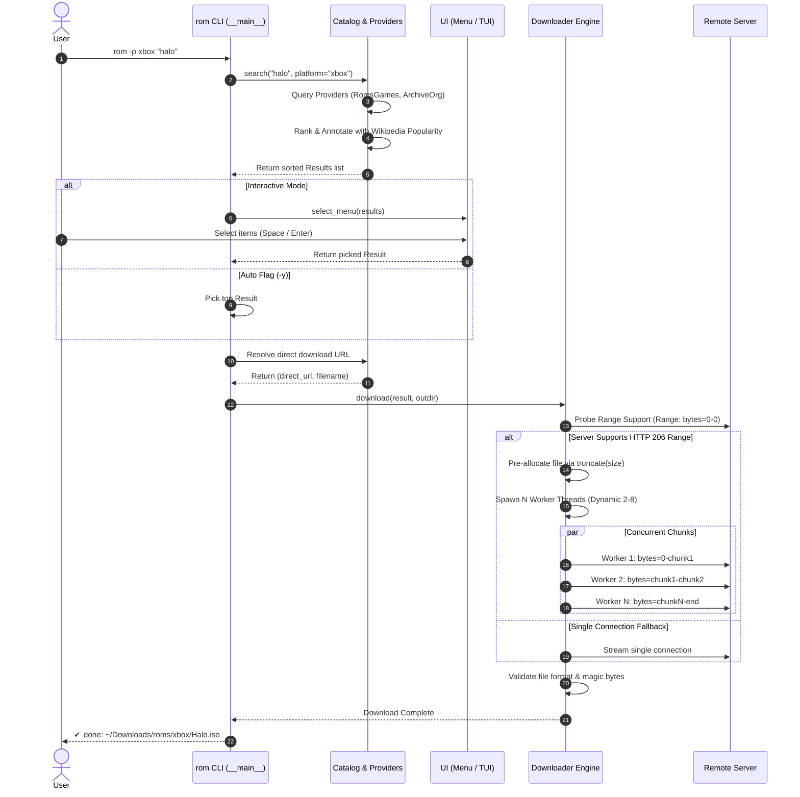
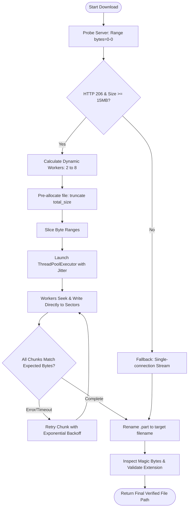

# System Architecture & Technical Design

This document details the architectural design, component interactions, concurrency model, and data flow of the `rom-cli` system.

---

## 1. High-Level Overview

`rom-cli` is a cross-platform command-line tool and Terminal User Interface (TUI) designed to search, resolve, and download retro gaming ROMs, ISOs, and packages across 26 platforms.

Originally structured as a monolithic single-file script, the codebase has been re-architected into a clean, decoupled modular Python package (`rom/`) backed by an **IDM-style multi-threaded segmented downloader engine** and a pluggable provider abstraction.

```
                           ┌────────────────────────────┐
                           │   CLI & TUI Entrypoints    │
                           │ (bin/rom, rom.__main__.py) │
                           └──────────────┬─────────────┘
                                          │
                  ┌───────────────────────┴───────────────────────┐
                  ▼                                               ▼
      ┌───────────────────────┐                       ┌───────────────────────┐
      │   Catalog & Search    │                       │   UI Subsystem        │
      │   (rom.catalog)       │                       │   (rom.ui)            │
      └───────────┬───────────┘                       └───────────────────────┘
                  │
      ┌───────────┴───────────┐
      ▼                       ▼
┌───────────────┐     ┌────────────────┐
│   Providers   │     │   Downloader   │
│(rom.providers)│     │(rom.downloader)│
└───────────────┘     └────────────────┘
```

---

## 2. Directory Structure

```text
rom-cli/
├── bin/
│   ├── rom                     # Lightweight wrapper (~15 LOC) forwarding to rom.__main__
│   └── rom-remote              # Remote sync utility script
│
├── rom/                        # Core Python package
│   ├── __init__.py             # Package metadata and version definition
│   ├── __main__.py             # CLI parser, command dispatcher, and signal handlers
│   ├── config.py               # Constants, platform registry (26 platforms), file paths
│   ├── utils.py                # Windows VT100/UTF-8 init, formatting, path validation
│   ├── catalog.py              # Search aggregator, Wikipedia rank scoring, catalog browsing
│   │
│   ├── downloader/             # Multi-threaded segmented downloader (IDM-style)
│   │   ├── __init__.py         # Public interface: download(), run_cli_download(), stream()
│   │   ├── engine.py           # Range probing, file pre-allocation, worker orchestration
│   │   ├── worker.py           # Per-chunk byte range fetcher, socket retry, offset writer
│   │   └── progress.py         # Thread-safe atomic progress tracker and ETA calculator
│   │
│   ├── providers/              # Data sources and link resolvers
│   │   ├── __init__.py         # Registry of singleton providers (SOURCES)
│   │   ├── base.py             # Result data model, BaseProvider contract, HTTP request helper
│   │   ├── dlarchive.py        # DlArchive API provider (Switch, NDS, GBA, SNES, PC)
│   │   ├── romsgames.py        # RomsGames provider (Xbox, Nintendo, Sega, Arcade, PS1/PS2)
│   │   ├── archive_org.py      # Internet Archive provider (Xbox ISOs, Homebrew ports)
│   │   ├── dlpsgame.py         # DlpsGame provider (PS3, PS4, PS5)
│   │   └── nopaystation.py     # NoPayStation TSV database provider (PS3, PSV, PSP, PS1)
│   │
│   └── ui/                     # Presentation layer
│       ├── __init__.py         # Exposes select_menu, show, run_tui, _has_textual
│       ├── menu.py             # CLI arrow-key selector (msvcrt on Windows, termios on Unix)
│       └── tui.py              # Full-screen reactive TUI powered by Textual
│
├── Makefile                    # Automation: install, install-bat, check, test, clean
├── install.bat                 # Windows CMD / PowerShell batch installer
├── install.sh                  # POSIX installer (Linux, macOS, Git Bash)
├── README.md                   # User guide and quickstart
└── ARCHITECTURE.md             # This document
```

---

## 3. Core Subsystems

### 3.1. Downloader Engine (`rom.downloader`)

Traditional downloaders fetch files using a single TCP connection. For servers with per-connection bandwidth throttling (e.g., `romsgames.net` or `archive.org`), single-thread downloads for large disc images (2–6 GB) are bottlenecked.

The `rom.downloader` subsystem implements an **Internet Download Manager (IDM)-style segmented parallel downloader**.

#### Key Features & Technical Decisions:

1. **Range Probing (`probe_url`)**:
   - Sends a lightweight `GET` request with header `Range: bytes=0-0`.
   - Validates if the server responds with `HTTP 206 Partial Content`.
   - Extracts the accurate file size from the `Content-Range: bytes 0-0/<total>` response header.

2. **Adaptive Concurrency**:
   - Files `< 15 MB`: Single connection (overhead of threading exceeds gains).
   - Files `15 MB – 50 MB`: 2 parallel worker threads.
   - Files `50 MB – 300 MB`: 4 parallel worker threads.
   - Files `300 MB – 1 GB`: 6 parallel worker threads.
   - Files `> 1 GB` (Xbox, PS2, PS3 ISOs): 8 parallel worker threads.

3. **Sparse File Pre-allocation (No Double Disk Space / No Merge Overhead)**:
   - *Traditional approach*: Download `part.0`, `part.1`, ... `part.N` and concatenate them after completion. This requires **2x the disk space** (a 4.6 GB ISO requires 9.2 GB of free space) and creates heavy sequential I/O disk wear during the merge phase.
   - *Our approach*: The target `.part` file is pre-allocated immediately via `file.truncate(total_size)`. Each worker opens an independent file descriptor in `r+b` mode, seeks to `start_byte + offset`, and writes directly to its designated sector. When all chunks finish, the file is already complete and simply renamed.

4. **Multi-Thread File Handling on Windows (`win32`)**:
   - Windows file locking can raise `PermissionError: [WinError 32]` when multiple threads share a file handle.
   - Each worker creates its own file handle via `open(target_file, "r+b")`, allowing concurrent, non-overlapping writes without lock collisions.

5. **Rate-Limiting & Anti-Ban Jitter**:
   - To prevent triggering anti-DDoS / HTTP 429 Too Many Requests (common on Archive.org), thread creation introduces a 50ms stagger jitter.

6. **Automatic Fallback Mechanism**:
   - If a host server ignores `Range` headers (returns `HTTP 200 OK` with full content instead of `206`), dynamic length is returned, or multi-part workers error, the engine automatically degrades to robust single-connection streaming with resume support.

7. **Thread-Safe Atomic Progress Tracking**:
   - `DownloadProgress` coordinates byte updates across threads using a mutex, rendering an accurate aggregate transfer rate (MB/s), percentage, and bytes transferred.

8. **Clean Signal Handling (`Ctrl+C`)**:
   - Utilizes `threading.Event` as a global cancellation token. Upon `SIGINT`, sockets close immediately, background workers terminate without hanging, and `.part` state is preserved.

---

### 3.2. Provider Subsystem (`rom.providers`)

The provider subsystem isolates catalog data retrieval and URL resolution per hosting service.

All providers conform to the `BaseProvider` contract:
```python
class BaseProvider:
    name: str
    def search(self, query: str, platform_key: str = None, on_progress = None, force: bool = False) -> list[Result]: ...
    def resolve(self, result: Result) -> tuple[str, str]: ...
```

#### Active Providers:

| Provider | Target Platforms | Protocol / Scraping Strategy |
|---|---|---|
| **DlArchive** (`dlarchive.py`) | Switch, NDS, GBA, SNES, PC | Multi-page JSON API indexing (`files_api.php`) with persistent cache |
| **RomsGames** (`romsgames.py`) | Xbox, NES, SNES, N64, GB, GBC, GC, Wii, PS1, PS2, PSP, Genesis, Saturn, Dreamcast, Arcade | AJAX hint search endpoint + CSRF/media-id form resolution |
| **ArchiveOrg** (`archive_org.py`) | Xbox (Redump), Switch Homebrew Ports, multi-platform backups | Advanced Search API (`advancedsearch.php`) + metadata JSON file extractor |
| **DlpsGame** (`dlpsgame.py`) | PS3, PS4, PS5 | WordPress REST API + hoster link extraction (1fichier, Google Drive, Mediafire) |
| **NoPayStation** (`nopaystation.py`) | PS3, PSV, PSP, PS1 | Raw Sony CDN database parsing via official TSV spreadsheets |

---

### 3.3. Catalog & Ranking Subsystem (`rom.catalog`)

Searches aggregate results from multiple providers simultaneously:
1. **Query Normalization (`norm`)**: Strips accents, punctuation, and converts queries into significant token sets.
2. **Wikipedia Sales Cross-Referencing (`load_popular`)**:
   - Fetches and caches best-seller game lists from Wikipedia.
   - Applies normalized title matching (`pop_rank`) to prioritize iconic commercial titles over ROM hacks, translation patches, or prototypes.
3. **Fuzzy Scoring Engine (`rank`)**:
   - Awards bonus points for exact phrase matches, base versions, and popular rankings.
   - Penalizes ROM hacks, prototypes, and demo titles unless explicitly queried.

---

### 3.4. User Interface Layer (`rom.ui`)

Supports two operational modes depending on user environment and flags:

1. **Reactive TUI Mode (`rom.ui.tui`)**:
   - Built with the `Textual` framework.
   - Full keyboard navigation: `↑↓` navigate, `Space` mark, `d` download, `p` switch platform, `n`/`b` paginate.
   - Asynchronous background worker threads for searching and batch downloading without freezing the UI.
2. **Interactive CLI Menu (`rom.ui.menu`)**:
   - Activated in standard terminal environments when running search queries without full TUI.
   - Cross-platform raw terminal input: uses `msvcrt` on Windows and `termios`/`tty` on Unix/macOS.

---

## 4. Architectural Flows

### 4.1. End-to-End Search & Download Flow



---

### 4.2. Downloader Engine Lifecycle



---

## 5. Cross-Platform Compatibility Matrix

| Feature | Windows (CMD / PowerShell) | Windows (Git Bash / MSYS2) | Linux / macOS |
|---|---|---|---|
| **Console Output** | ANSI VT100 enabled via `ctypes` (`kernel32.SetConsoleMode`) | Native ANSI VT100 | Native ANSI VT100 |
| **Encoding** | `sys.stdout/stderr` forced to UTF-8 | UTF-8 | UTF-8 |
| **CLI Interactive Menu** | Native non-blocking `msvcrt.getwch()` | `msvcrt` or `termios` fallback | `termios` / `tty` raw mode |
| **Path Handling** | Auto-handles `USERPROFILE`, backslashes, `.cmd` wrapper | Converts POSIX paths to Windows paths | Standard POSIX paths |
| **Make Automation** | `cmd.exe //c install.bat` (escaped for MSYS conversion) | `bash ./install.sh` | `bash ./install.sh` |

---

## 6. How to Add a New Provider

Adding a new ROM source requires 3 simple steps:

1. **Create the provider module** in `rom/providers/<name>.py`:
   ```python
   from rom.providers.base import BaseProvider, Result, request

   class CustomProvider(BaseProvider):
       name = "custom"
       
       def search(self, query, platform_key=None, on_progress=None, force=False):
           # Perform query, return list of Result instances
           return [Result(self.name, "Title", "Platform", "https://page-url")]

       def resolve(self, result):
           # Extract direct download link and filename
           return "https://direct-download-link.bin", "Filename.zip"
   ```

2. **Register the provider** in `rom/providers/__init__.py`:
   ```python
   from rom.providers.custom import CustomProvider
   CUSTOM = CustomProvider()
   SOURCES["custom"] = CUSTOM
   ```

3. **Map platforms** in `rom/config.py`:
   ```python
   PLATFORMS["new_platform"] = ("custom", "api_key_or_param")
   ```
